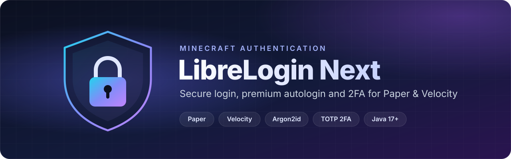

<p align="center">
  
</p>

<p align="center">
  <a href="https://github.com/samupro-dev/LibreLoginNext/actions/workflows/build.yml"></a>
  
  
  
  <a href="LICENSE"></a>
  <a href="https://discord.gg/rD8TZzSYZB"></a>
</p>

<h3 align="center">High-Concurrency Security. Zero-Latency Authentication.</h3>

<p align="center">
  The modern authentication suite engineered for Velocity 3.x/4.x proxies and standalone Paper networks.<br>
  Supporting Minecraft clients 1.7 through 26.3 with instant Mojang AutoLogin, in-game 2FA map projection on Velocity,<br>
  Redis clustering and GDPR-grade IP salting.
</p>

---

## Table of contents

- [Highlights](#highlights)
- [Core pillars](#core-pillars)
- [Reliability & performance](#reliability--performance)
- [Compatibility](#compatibility)
- [Installation](#installation)
- [Configuration](#configuration)
- [Commands & permissions](#commands--permissions)
- [Migrating from another plugin](#migrating-from-another-plugin)
- [Why LibreLogin Next?](#why-librelogin-next)
- [Why is the jar ~27 MB?](#why-is-the-jar-27-mb)
- [Developer API](#developer-api)
- [Building from source](#building-from-source)
- [About the project](#about-the-project)
- [Acknowledgments](#acknowledgments)
- [License](#license)

## Highlights

| | |
|---|---|
| 🛡️ **Cryptographic core** | Memory-hard password hashing: **Argon2id** by default, plus BCrypt-2A, SCrypt and PBKDF2, with constant-time verification against timing attacks. |
| 🗄️ **Zero-leak storage** | Managed connection pool for MySQL, MariaDB, PostgreSQL and SQLite, backed by in-memory L1 Caffeine caches with secondary indexes. |
| 🌐 **Redis cluster mesh** | RESP3 state synchronisation: non-blocking player presence tracking and real-time Pub/Sub cache eviction across proxies. |
| ⚠️ **Fail-closed circuit breaker** | After 3 consecutive database failures new logins are refused; a health probe re-enables them automatically once the database recovers. |

## Core pillars

### 🔑 Instant Mojang AutoLogin
Official Minecraft accounts log in automatically without typing a password, while cracked players are guided through secure registration.

- **Zero-click access** — premium accounts skip the password prompt and join the lobby instantly.
- **Spoof protection** — nobody can steal a registered nickname or join with different casing.
- **Conflict handling** — configurable strategies `BLOCK`, `USE_OFFLINE` or `OVERWRITE` when offline and premium names collide.

```text
Premium (Alex): verified Mojang session  ➜  instant lobby access
Cracked (Steve): unregistered account    ➜  guided to /register
```

### 📱 In-game 2FA map projection
On **Velocity with Protocolize**, players hold a generated Minecraft map that displays their 2FA QR code directly in-game — no need to switch windows or open a browser. On **Paper** (and for 1.7–1.12 clients) the secret key is shown in chat for manual entry.

- Works with Google Authenticator, Microsoft Authenticator, Authy and every TOTP app.
- Setup flow: **`/2fa`** ➜ hold the map / copy the key ➜ scan with your app ➜ **`/2fa confirm <code>`**.

### 🔁 Multi-proxy synchronisation (Redis)
Connect multiple Velocity proxies into one unified network with instant cache updates and global player tracking.

- **Real-time sync** — password changes and 2FA activations propagate to every proxy simultaneously.
- **Global presence** — automatic heartbeats prevent duplicate sessions across proxies.
- **Global session control** — logging in on one proxy kicks the older session on any other proxy; staff commands act on the shared database.

### 🕶️ Privacy & GDPR compliance
- **Salted IP hashing** — IP addresses are hashed with HMAC-SHA256, so raw IPs never reach the database.
- **Right to be forgotten** — `/librelogin user forget <name>` permanently erases all records of a player.
- **Automated account prune** — inactive profiles past your retention limit are cleaned up automatically.

## Reliability & performance

| Component | What it does |
|---|---|
| ⚡ **L1 in-memory cache** | Indexes users by UUID, case-insensitive nickname and Mojang premium UUID, with automatic synchronisation. |
| 🗃️ **HikariCP connection pool** | Strict leak-detection thresholds, server-side prepared-statement caches and safe query encapsulation on every supported database. |
| 🔒 **Fail-closed circuit breaker** | Continuously monitors database health. After 3 consecutive failures logins are refused instead of letting unauthenticated players through; a probe every 5 seconds re-enables them as soon as the database recovers. |

## Compatibility

| Platform | Versions | Status | Notes |
|---|---|:---:|---|
| **Velocity** | `3.x` & `4.x` | ✅ Primary target | Async non-blocking pipeline, in-game 2FA maps (with Protocolize), Redis clustering. |
| **Paper** | `1.13.2` – `26.3` | ✅ Fully supported | Proxy detection, spawn-location handling, packet listeners. Requires **PacketEvents**. |
| **Client protocols** | `1.7` – `26.3` | ✅ Universal | Full authentication and session support. |
| **Bedrock Edition** | Floodgate `2.2.5+` | ✅ Compatible | Automatic Floodgate UUID detection and cracked/premium resolution bypass. |
| **BungeeCord** | — | ❌ Not supported | Use Velocity instead. |
| **Java runtime** | 17 – 25 | ✅ Verified | Compiled to Java 17 bytecode; tested on JDK 17, 21 and 25. |

## Installation

### Velocity (network)
1. Download the latest LibreLogin Next jar from [Modrinth](https://modrinth.com/mod/librelogin-next) or [build it yourself](#building-from-source).
2. Put the jar in the proxy's `plugins/` folder — **do not** install it on the backend servers. Add [Protocolize](https://github.com/Exceptionflug/protocolize) to enable in-game 2FA QR maps.
3. Start the proxy once to generate the configuration.
4. Set the `limbo` server(s) where players authenticate and the `lobby` servers they are sent to afterwards.
5. Configure a shared database (MySQL/MariaDB or PostgreSQL) and, for multiple proxies, enable Redis.
6. Restart the proxy or run `/librelogin reload`.

### Paper (standalone server)
1. Install [PacketEvents](https://modrinth.com/plugin/packetevents) in `plugins/`.
2. Download LibreLogin Next from [Modrinth](https://modrinth.com/mod/librelogin-next).
3. Drop the LibreLogin Next jar in `plugins/` and start the server once.
4. Edit `plugins/LibreLogin/config.conf`, then run `/librelogin reload`.

> [!TIP]
> Keep limbo servers in offline mode behind the proxy and make sure players cannot reach them directly.

## Configuration

Two HOCON files are generated on first start: **`config.conf`** (settings) and **`messages.conf`** (all player-facing text, with [MiniMessage](https://docs.advntr.dev/minimessage/format.html) formatting). Every option is documented inline.

```hocon
# LibreLogin Next - example configuration
default-crypto-provider = "Argon-2ID"
require-password-confirmation = true
allow-player-unregister = false
profile-conflict-resolution-strategy = "BLOCK"

redis {
  enabled = true
  host = "127.0.0.1"
  port = 6379
  password = "change-me"
}

privacy {
  ip-storage-mode = "HASHED"          # HMAC-SHA256
  ip-hash-salt = "<long-random-secret>"
  auto-purge-inactive-days = 90
}

session-timeout = 43200               # 12-hour session (0 = disabled)
```

| Key | Default | Description |
|---|---|---|
| `database.type` | `librelogin-sqlite` | `librelogin-sqlite`, `librelogin-mysql` or `librelogin-postgresql`. |
| `default-crypto-provider` | `Argon-2ID` | `Argon-2ID`, `BCrypt-2A`, `SCrypt` or `PBKDF2` for new passwords. |
| `auto-register` | `false` | Register premium players automatically without a password. |
| `session-timeout` | `43200` | Session length in seconds (`0` = always ask for the password). |
| `seconds-to-authorize` | `60` | Time a player has to log in before being kicked. |
| `max-login-attempts` | `3` | Wrong passwords allowed before kick. |
| `login-security.max-ip-login-attempts` | `10` | Failed attempts per IP across all accounts (`-1` = disabled). |
| `ip-limit` | `-1` | Max registered accounts per IP (`-1` = unlimited). |
| `minimum-password-length` | `6` | Minimum password length. |
| `privacy.ip-storage-mode` | `PLAIN` | `PLAIN` or `HASHED` (HMAC-SHA256 with `privacy.ip-hash-salt`). |
| `privacy.auto-purge-inactive-days` | `0` | Remove accounts inactive for N days (`0` = disabled). |
| `totp.enabled` | `true` | Enable `/2fa`. |
| `mail.enabled` | `false` | Enable e-mail password recovery (configure the `mail.*` SMTP settings). |
| `redis.enabled` | `false` | Sync sessions and presence across proxies. |

> [!WARNING]
> When using `ip-storage-mode = "HASHED"`, always replace the default `ip-hash-salt` with a long random secret.

## Commands & permissions

All permissions live under `librelogin.*`. **No permission is granted by default.**

### Player commands

| Command | Aliases | Syntax | Permission | Description |
|---|---|---|---|---|
| `/login` | `/l` | `<password> [2fa_code]` | `librelogin.command.login` | Log in to a registered account. |
| `/register` | `/reg` | `<password> [repeatPassword]` | `librelogin.command.register` | Register; the repeat is optional when confirmation is disabled. |
| `/unregister` | — | `<password>` | `librelogin.command.unregister` | Self-unregister and wipe credentials. |
| `/changepassword` | `/changepass` | `<oldPassword> <newPassword>` | `librelogin.command.changepassword` | Change your password. |
| `/premium` | — | `<password>` · `confirm` | `librelogin.command.premium` | Enable Mojang AutoLogin. |
| `/cracked` | — | `[password] [repeatPassword]` | `librelogin.command.cracked` | Disable AutoLogin; accounts without a password set one in the same step. |
| `/2fa` | `/totp` | — · `confirm <code>` · `disable <password>` | `librelogin.command.2fa` | Start TOTP setup, confirm it, or disable it after a password check. |
| `/email` | — | `set <address> <password>` · `verify <code>` · `reset` · `reset confirm <code> <newPass> <repeat>` | `librelogin.command.email` | Manage your recovery e-mail and reset your password. |

### Staff commands — `/librelogin`

| Subcommand | Arguments | Permission | Description |
|---|---|---|---|
| `about` | — | — | Version, author and repository information. |
| `health` | — | `librelogin.admin.health` | Real-time platform diagnostics. |
| `dump` | — | `librelogin.admin.dump` | Generate a diagnostic JSON dump. |
| `reload` | `[config\|configuration\|messages]` | `librelogin.admin.reload` | Hot-reload `config.conf` and/or `messages.conf`. |
| `email test` | `<email>` | `librelogin.admin.email.test` | Send an SMTP test e-mail. |
| `user info` | `<name>` | `librelogin.admin.user.info` | Inspect a full user profile. |
| `user migrate` | `<name> <newName>` | `librelogin.admin.user.migrate` | Move credentials and records to a new nickname. |
| `user forget` | `<name>` | `librelogin.admin.user.forget` | Disconnect the player and permanently erase all data. |
| `user delete` | `<name>` | `librelogin.admin.user.delete` | Permanently delete the user record. |
| `user unregister` | `<name>` | `librelogin.admin.user.unregister` | Remove password, 2FA, premium link, stored IP and last login while keeping the record. |
| `user premium` | `<name>` | `librelogin.admin.user.premium` | Switch an account to Mojang AutoLogin. |
| `user cracked` | `<name>` | `librelogin.admin.user.cracked` | Switch an account back to password login. |
| `user register` | `<name> <password>` | `librelogin.admin.user.register` | Create and register an account. |
| `user login` | `<name>` | `librelogin.admin.user.login` | Force-authorise an online player. |
| `user remove2fa` | `<name>` | `librelogin.admin.user.remove2fa` | Remove the TOTP secret. |
| `user removeemail` | `<name>` | `librelogin.admin.user.removeemail` | Clear the recovery e-mail. |
| `user setemail` | `<name> <email>` | `librelogin.admin.user.setemail` | Set a recovery e-mail. |
| `user setpassword` | `<name> <password>` | `librelogin.admin.user.setpassword` | Change a user's password. |
| `user alts` | `<name>` | `librelogin.admin.user.alts` | List accounts sharing the same IP (or IP hash). |

| Other permission | Description |
|---|---|
| `librelogin.limbo.access` | Lets an authenticated player teleport into a limbo world (Paper only). |

## Migrating from another plugin

Import existing credentials and player history without downtime.

| Source | Tested version | What is imported |
|---|---|---|
| **AuthMeReloaded** | v6.0.1 | BCrypt and Argon2 passwords converted to the standard format; SQLite, MySQL and PostgreSQL with automatic timestamp resolution. |
| **FastLogin** | v1.12 | Premium UUID bindings, cracked account mappings and player history. |
| **LoginTo** | v4.1.0 | Credentials, registration dates and password hashes. |
| **LibreLogin / LibreLoginProd** | any | Both modern and legacy database columns. |

1. Set `migration.type` to one of `authme-sqlite`, `authme-mysql`, `authme-postgresql`, `fastlogin-sqlite`, `fastlogin-mysql`, `loginto-sqlite`, `loginto-mysql`, `librelogin-migration-sqlite`, `librelogin-migration-mysql`, `librelogin-migration-postgresql`.
2. Fill in the `migration.old-database` connection details and set `migration.on-next-startup = true`.
3. Restart. Legacy hashes (SHA-256, SHA-512, LogIt) stay verifiable, so players keep their existing passwords.

## Why LibreLogin Next?

| Feature | LibreLogin Next | Legacy LibreLogin | AuthMeReloaded | FastLogin | LoginTo |
|---|:---:|:---:|:---:|:---:|:---:|
| Velocity 3.x & 4.x | ✅ Native | 3.x only | Bukkit only | Hook only | Native |
| Paper 1.13.2 – 26.3 | ✅ Universal | Outdated | Patchy | Patchy | Basic |
| Redis multi-proxy mesh | ✅ | ❌ | MySQL only | Basic Bungee | ❌ |
| Fail-closed circuit breaker | ✅ | ❌ | ❌ | ❌ | ❌ |
| Salted IP privacy & GDPR forget | ✅ | Plaintext | Plaintext | Plaintext | Plaintext |
| In-game 2FA map projection | ✅ Dynamic QR | Legacy NBT | Chat only | ❌ | Basic |
| Self-contained shaded jar | ✅ | Runtime downloader | Mixed | Mixed | ✅ |
| Zero telemetry / tracking | ✅ | Telemetry | Telemetry | Telemetry | ✅ |

## Why is the jar ~27 MB?

Every dependency is **shaded and relocated directly into the jar** instead of being downloaded at runtime.

| | Runtime downloaders | LibreLogin Next |
|---|---|---|
| **Size** | ~5 MB stub + 20+ jars downloaded on boot | ~27 MB standalone jar |
| **Security** | Executes bytecode fetched over the network — exposed to mirror outages, DNS spoofing and compromised repositories. | Nothing is downloaded from Maven mirrors at startup. |
| **Startup** | Fails to boot if Maven Central or a mirror is slow, down or rate-limited. | Starts reliably in air-gapped, firewalled and Docker environments. |
| **Classpath** | Libraries injected into the shared classloader can cause `NoSuchMethodError` clashes. | Every library is relocated to `xyz.kyngs.librelogin.lib.*` — no conflicts with other plugins. |

The only network calls are the optional forbidden-password list download (`forbidden-passwords-download`) and the Modrinth update check (`check-for-updates`); both can be disabled.

## Developer API

Both platform bootstraps implement `LibreLoginProvider`, which exposes the `LibreLoginPlugin` instance (events, database, crypto providers and more).

```java
public void hook(LibreLoginPlugin<?, ?> plugin) {
    var events = plugin.getEventProvider();
    var types = events.getTypes();

    // Listen for player authorisations
    events.subscribe(types.authenticated, event -> {
        var user = event.getUser();
        plugin.getLogger().info("Authorized " + user.getLastNickname() + " via " + event.getReason());
    });

    // Audit password changes
    events.subscribe(types.passwordChange, event ->
            plugin.getLogger().warn("Password changed: " + event.getUser().getLastNickname()));
}
```

Available events: `authenticated`, `wrongPassword`, `passwordChange`, `premiumLoginSwitch`, `limboServerChoose`, `lobbyServerChoose`.

## Building from source

Requires **JDK 25** (bytecode targets Java 17).

```bash
git clone https://github.com/samupro-dev/LibreLoginNext.git
cd LibreLoginNext
./gradlew build shadowJar
```

The jar is written to `target/LibreLoginNext-<version>.jar`. Run `./gradlew spotlessApply` before opening a pull request.

| Module | Content |
|---|---|
| `API/` | Public API (`xyz.kyngs.librelogin.api`). |
| `Plugin/` | Paper and Velocity implementations and the shared core. |
| `Libraries/` | Relocated Adventure and Lettuce bundled in the jar. |

## About the project

**From private tool to public standard.** LibreLogin Next started as a private, in-house solution for a high-concurrency Minecraft server. Its architectural changes, security hardening and stability fixes proved useful well beyond that network, so it is now open source — a reliable, modern and maintained authentication plugin without bloat.

- 🤖 **AI-assisted development** — modern workflows with AI-assisted engineering and rigorous auditing speed up features, improve reliability and clear legacy architectural issues faster.
- 🤝 **Community driven** — pull requests are warmly welcome, whether you fix an edge case, add an integration or improve the docs.

Questions or feedback? **[Join our Discord](https://discord.gg/rD8TZzSYZB)**.

## Acknowledgments

This project stands on the shoulders of giants:

- **[LibreLoginProd](https://github.com/Navio1430/LibreLoginProd)** by Navio1430 — pioneering support for modern Minecraft versions and network architectures.
- **[LibreLogin](https://github.com/kyngs/LibreLogin)** by kyngs — the original plugin architecture and security foundation.
- **[Our contributors](https://github.com/samupro-dev/LibreLoginNext/graphs/contributors)** — everyone who submits pull requests, reports bugs and tests releases.

## License

LibreLogin Next is an open-source fork of LibreLoginProd, licensed under the **Mozilla Public License 2.0** — see [LICENSE](LICENSE).
